> [!NOTE]
> **This is a fork of [SVF-tools/SVF](https://github.com/SVF-tools/SVF) implementing a linear-algebra-based CFL reachability solver.**
> * **Status:** Pending merge into the main repository (see [PR #XXX](https://github.com/SVF-tools/SVF/pull/XXX)).
> * **Branch goal:** Demonstrate the performance gains and benchmarks of the new method.
> * The original project documentation is [below](#news).

---

# Linear-Algebra-Based CFL Reachability Solver

## TL;DR

Replaces the standard worklist-based CFL reachability algorithm with a Boolean-matrix (linear algebra) formulation solved by [LAGraph](https://github.com/Aleksey2509/LAGraph), achieving up to ~36× speedup and 1.1–2.5× lower peak memory on potential-aliasing analysis over 20 open-source projects (SPEC CPU 2017 + Phoronix Test Suite).
The optimized solver implements the algorithm of [Muravev & Grigorev, STTT 2026](https://link.springer.com/article/10.1007/s10009-026-00864-y) on top of the matrix CFL reachability of [Azimov & Grigorev (GRADES/NDA 2018)](https://doi.org/10.1145/3210259.3210264), as implemented in the [LAGraph](https://github.com/Aleksey2509/LAGraph) fork (tag `homka122/CFL_optimizations`).

## How it works

Both solvers express CFL reachability as a closure over Boolean matrices: the grammar is converted to (extended) weak Chomsky normal form, each terminal becomes an adjacency matrix, and the fixed point is computed with sparse matrix multiplication (SuiteSparse:GraphBLAS). `MTXSolver` implements the base algorithm of [Azimov & Grigorev](https://doi.org/10.1145/3210259.3210264); `AdvMTXSolver` adds the optimizations of [Muravev & Grigorev](https://link.springer.com/article/10.1007/s10009-026-00864-y) — incremental computation, storage-format management, lazy matrix addition, and block multiplication for indexed rule families — via the [LAGraph](https://github.com/Aleksey2509/LAGraph) fork.

Two solvers are provided, selectable via CLI flags:

| Solver | Class | Backend call | Notes |
|---|---|---|---|
| Matrix | `MTXSolver` | `LAGraph_CFL_reachability` | Direct port of the standard matrix algorithm |
| Advanced matrix | `AdvMTXSolver` | `LAGraph_CFL_reachability_adv` | Adds LAGraph optimization bitmask; requires a uniformly indexed grammar |

Implementation: [`svf/include/CFL/CFLSolver.h`](svf/include/CFL/CFLSolver.h) · [`svf/lib/CFL/CFLAlias.cpp`](svf/lib/CFL/CFLAlias.cpp) · [`svf-llvm/tools/CFL/cfl.cpp`](svf-llvm/tools/CFL/cfl.cpp)

## Benchmarks

### Test environment

| Component | Specification |
|---|---|
| OS | Ubuntu 24.04 |
| CPU | Intel Core i9-13905H (14 cores / 20 threads) |
| RAM | 32 GB |
| LLVM | <STUB: version> |

### Dataset

19 open-source projects (20 benchmark configurations) from [SPEC CPU 2017](https://www.spec.org/cpu2017/) and the [Phoronix Test Suite](https://www.phoronix-test-suite.com/): a compiler, an archiver, 3D renderers, video codecs, and telecom protocol stacks. Each project is compiled to LLVM IR (`clang -save-temps`), `mem2reg` is applied via `opt`, and each IR file is analyzed as a separate unit. CFL graph sizes per project:

| Project | Source | Files | Median vertices | Max vertices | Median edges | Max edges |
|---|---|---:|---:|---:|---:|---:|
| povray | [POV-Ray/povray](https://github.com/POV-Ray/povray) | 69 | 1739 | 7696 | 3174 | 37756 |
| blender | [blender/blender](https://github.com/blender/blender) | 732 | 1469.5 | 23821 | 2639 | 79074 |
| srsRAN | [srsran/srsRAN](https://github.com/srsran/srsRAN) | 12 | 3432.5 | 10552 | 6614 | 19840 |
| srsRAN_4G | [srsran/srsRAN](https://github.com/srsran/srsRAN) (4G build) | 52 | <STUB> | <STUB> | <STUB> | <STUB> |
| gcc_r | [gcc-mirror/gcc](https://github.com/gcc-mirror/gcc) | 174 | 2079 | 7922 | 4954 | 353704 |
| x264 | [mirror/x264](https://github.com/mirror/x264) | 50 | 1751.5 | 22652 | 3485 | 79572 |
| nab | [SPEC CPU 2017 544.nab_r](https://www.spec.org/cpu2017/) (source not public) | 7 | 3428 | 4815 | 7856 | 88436 |
| xz | [tukaani-project/xz](https://github.com/tukaani-project/xz) | 6 | 1467 | 3051 | 3455 | 7554 |
| SVT-AV1 | [AOMediaCodec/SVT-AV1](https://github.com/AOMediaCodec/SVT-AV1) | 72 | 3236.5 | 25620 | 6892 | 174638 |
| SVT-HEVC | [OpenVisualCloud/SVT-HEVC](https://github.com/OpenVisualCloud/SVT-HEVC) | 22 | 3478 | 9354 | 5042 | 32880 |
| SVT-VP9 | [OpenVisualCloud/SVT-VP9](https://github.com/OpenVisualCloud/SVT-VP9) | 10 | 5420 | 10514 | 9402 | 22488 |
| aom | [aomedia/aom](https://aomedia.googlesource.com/aom/) | 97 | 2752 | 16996 | 6256 | 36090 |
| kvazaar | [ultravideo/kvazaar](https://github.com/ultravideo/kvazaar) | 4 | 5090 | 5179 | 10806 | 12656 |
| dav1d | [videolan/dav1d](https://github.com/videolan/dav1d) | 4 | 3424 | 4891 | 7060 | 9576 |
| ffmpeg | [FFmpeg/FFmpeg](https://github.com/FFmpeg/FFmpeg) | 1264 | 727.5 | 36228 | 1298 | 84284 |
| libgav | [chromium/libgav1](https://chromium.googlesource.com/codecs/libgav1) | 30 | 2693 | 7394 | 5036 | 16268 |
| openapv | [AcademySoftwareFoundation/openapv](https://github.com/AcademySoftwareFoundation/openapv) | 3 | 2626 | 4268 | 5428 | 8360 |
| uvg266 | [ultravideo/uvg266](https://github.com/ultravideo/uvg266) | 16 | 3521.5 | 15780 | 7570 | 36834 |
| vvenc | [fraunhoferhhi/vvenc](https://github.com/fraunhoferhhi/vvenc) | 46 | 2753.5 | 7469 | 7014 | 17430 |
| x265 | [Multicorewareinc/x265](https://github.com/Multicorewareinc/x265) | 15 | 4850 | 14552 | 9310 | 22784 |

### Methodology

Two SVF grammars for the potential-aliasing problem: **copy-grammar** (direct dataflow only) and **mem-grammar** (+ memory-mediated flow). Metrics: CFL algorithm runtime and peak RSS (`/usr/bin/time -v`, 32 GB cap). The time comparison uses only modules taking ≥ 1 s in every solver (to reduce noise); the memory comparison uses all modules with valid measurements. Single-threaded solvers are pinned to one core (`taskset -c 0`); multithreaded solvers use all 20 threads. Values are geometric means over modules per program.

### Results

**Analysis.** AdvMTX is the fastest solver on every program and grammar. The base MTX solver is also faster than the worklist baseline, but does not consistently beat POCR/POCRHybrid. The effect of the optimizations is input-dependent: on SVT-VP9 and SVT-HEVC (mem) MTX and AdvMTX are comparable, while on libgav (mem) the difference is substantial. Both matrix solvers use less peak memory than the graph solvers (which exceed the baseline); AdvMTX uses slightly more than MTX. Overall: up to ~36× speedup and 1.1–2.5× lower peak memory.

Detailed per-file results (all modules, both grammars): [`evaluation_raw_data/RESULTS.md`](evaluation_raw_data/RESULTS.md)

### Reproducing

```bash
./scripts/benchmark.sh   # <STUB: script to be added; runs all three solvers over the suite, prints the table above>
```

Manual run on a single program:

```bash
source ./build.sh
./build/bin/cfl --cfl-alias-measure-algo-runtime program.bc                        # baseline
./build/bin/cfl --mtx-alias --cfl-alias-measure-algo-runtime program.bc            # matrix
./build/bin/cfl --adv-mtx-alias --cfl-alias-measure-algo-runtime program.bc        # advanced matrix
```

## Visualization

Per-benchmark results from the evaluation run (all five solvers; per-file data in [`evaluation_raw_data/RESULTS.md`](evaluation_raw_data/RESULTS.md)). Time figures first, then memory.

**Per-file runtime distribution** (violin, log scale)

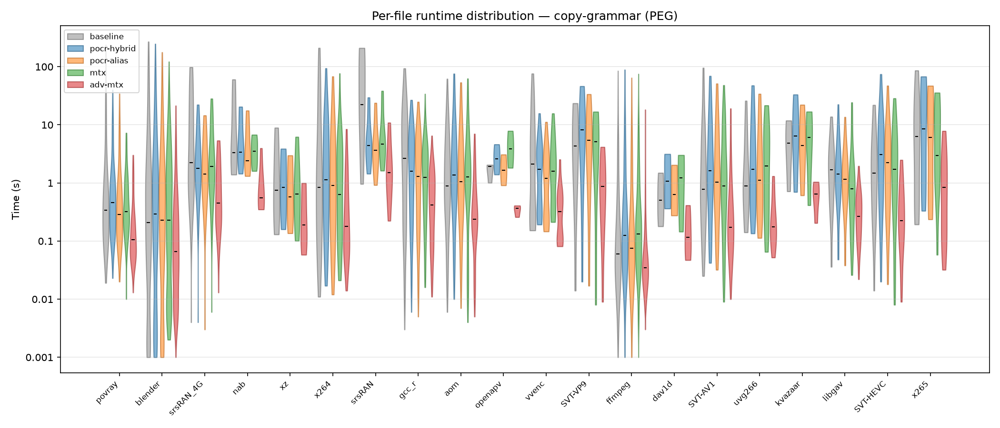
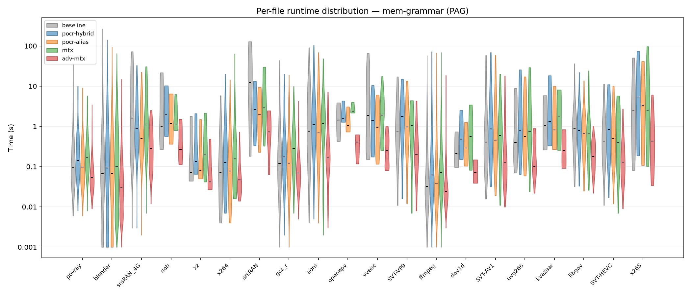

**Speedup vs baseline** (geometric mean over modules)

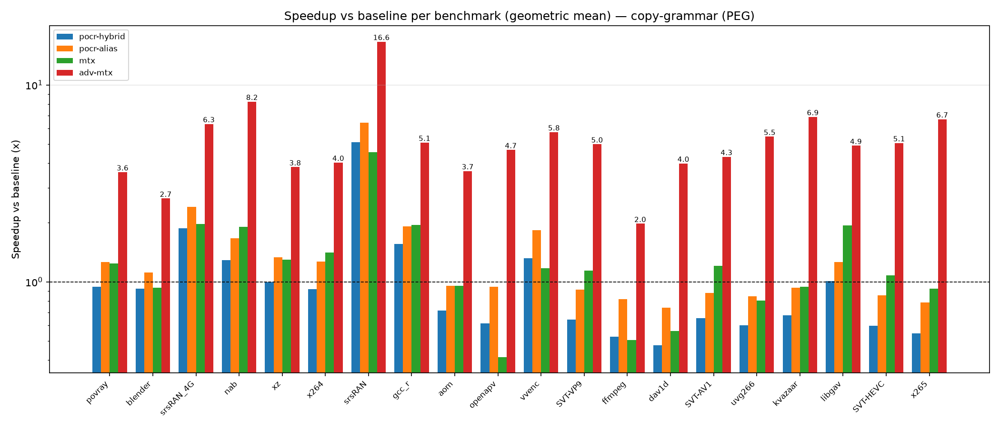
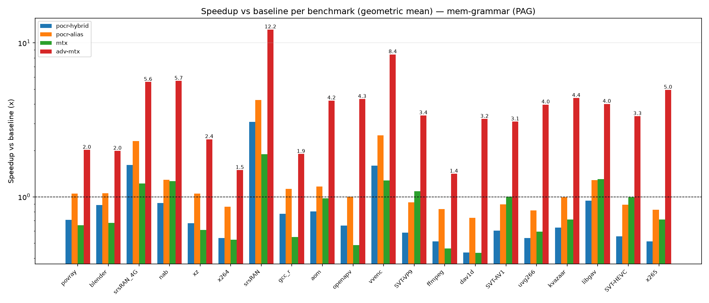

**Total runtime** (sum over modules)

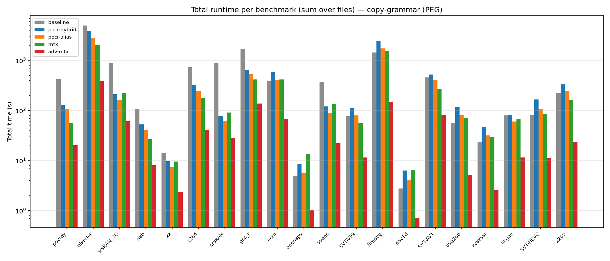
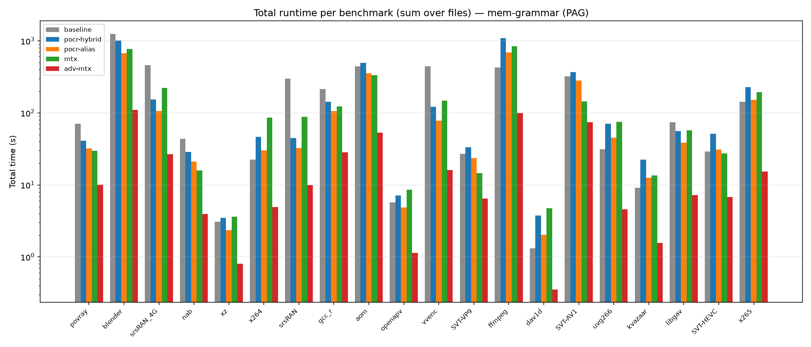

**Speedup vs baseline** (total time)

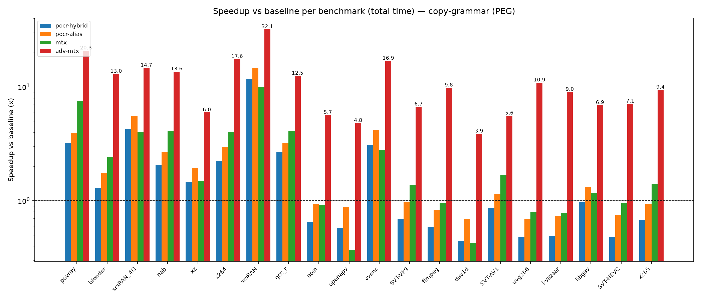
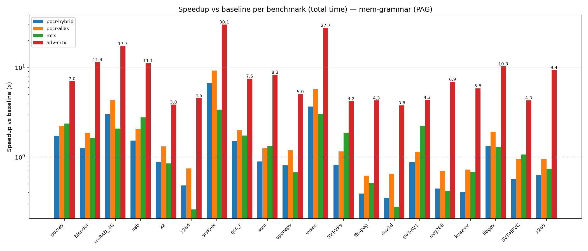

**Per-file peak memory distribution** (violin)

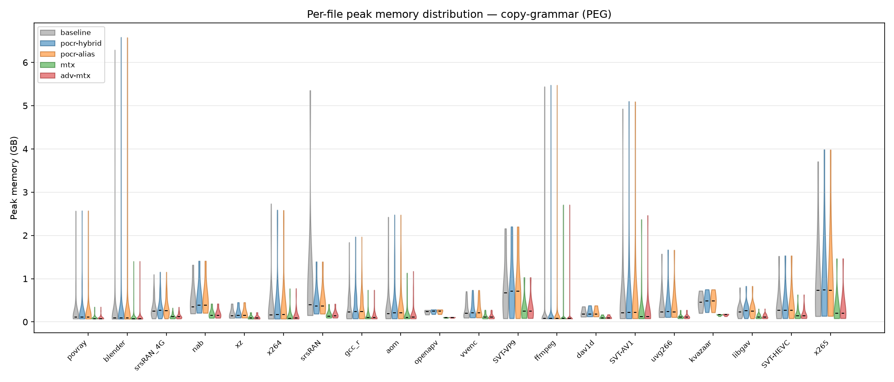
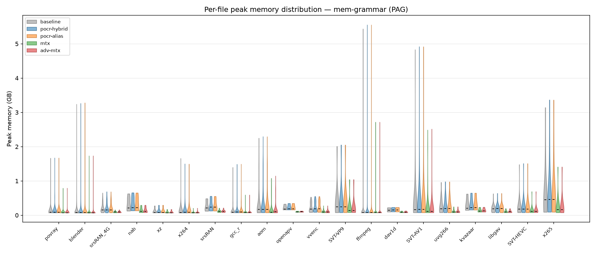

**Memory improvement vs baseline** (> 1 = less memory)

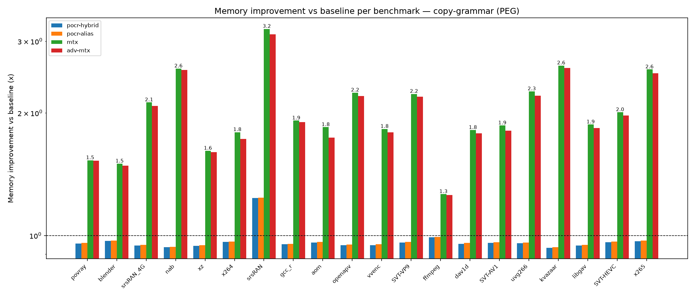
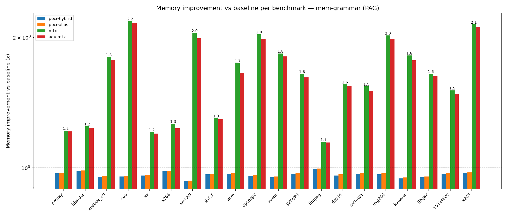

**Geometric-mean peak memory**

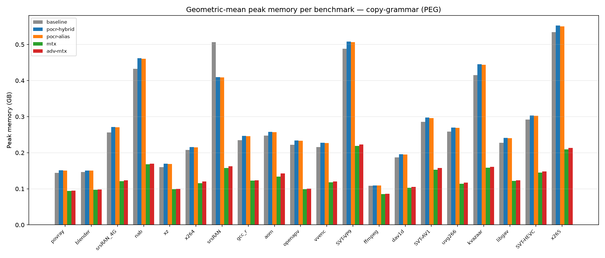
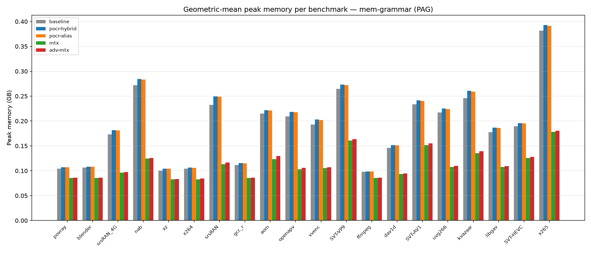

## Quickstart

```bash
source ./build.sh
./build/bin/cfl --adv-mtx-alias program.bc
```

New CLI options:

| Flag | Description | Default |
|---|---|---|
| `--mtx-alias` | Use the matrix-based CFL solver | off |
| `--adv-mtx-alias` | Use the advanced matrix-based CFL solver | off |
| `--adv-mtx-optimizations=<mask>` | LAGraph optimization bitmask: `1`=empty, `2`=format, `4`=lazy, `8`=block | `7` |
| `--mtx-only-starting` | Copy back only start-nonterminal edges from the matrix result | on |

## Implementation notes (for reviewers)

* **Changed files:** `svf/include/CFL/{CFLSolver,CFLAlias,CFLVF}.h`, `svf/lib/CFL/{CFLSolver,CFLAlias,CFLVF}.cpp`, `svf-llvm/tools/CFL/cfl.cpp`, `svf/lib/Util/Options.{h,cpp}`, `CMakeLists.txt`, `svf/CMakeLists.txt`, plus supporting changes across the rest of the CFL module (grammar normalization, epsilon rules, non-consecutive attributes).
* **New dependency:** [LAGraph](https://github.com/Aleksey2509/LAGraph) (fork, tag `homka122/CFL_optimizations`), fetched via CMake `FetchContent`.
* **Limitations:** `AdvMTXSolver` requires uniformly indexed grammar rules: consecutive instance numbering, identical index sets for all indexed symbols within a rule, and complete rule families (it aborts otherwise). Non-conforming grammars can be expanded explicitly (semantics preserved) but lose the block optimization. Incremental updates re-run the full matrix solve.
* **Correctness:** The matrix solvers compute the same CFL reachability relation as the built-in solvers; all solvers were evaluated on identical input graphs and grammars.

---


SVF provides reusable abstractions, graphs, and solvers for analyzing LLVM IR.

## News
* <b>[MSli](https://github.com/SVF-tools/SVF/wiki/MTA-MSli), an on-demand program slicing tool for multithreaded programs, is now available in [SVF/MTA](https://github.com/SVF-tools/SVF/tree/master/svf/include/MTA). </b>
* <b>SVF now supports [LLVM-22](https://github.com/SVF-tools/SVF/pull/1876) (Contributed by [Giorgio](https://github.com/dg1474)). </b>
* <b>SVF now supports [LLVM-21](https://github.com/SVF-tools/SVF/pull/1815) (Contributed by [cjsrxzdyzds](https://github.com/cjsrxzdyzds)). </b>
* <b>SVF now supports new [build system](https://github.com/SVF-tools/SVF/pull/1703) (Thank [Johannes](https://github.com/Johanmyst) for his help!). </b>
* <b> [SVF-Python](https://github.com/SVF-tools/SVF-Python) is now available, enabling developers to write static analyzers in Python by leveraging the SVF library (Contributed by [Jiawei Wang](https://github.com/bjjwwang)). </b>
* <b>New course [Software Security Analysis](https://github.com/SVF-tools/Software-Security-Analysis) for learning code analysis and verification with SVF for fun and expertise! </b>
* <b>SVF now supports LLVM-16.0.0 with opaque pointers (Contributed by [Xiao Cheng](https://github.com/jumormt)). </b>
* <b>Modernize SVF's CMake (Contributed by [Johannes](https://github.com/Johanmyst)). </b>

<details>
<summary>Older news</summary>

* <b>SVF now supports LLVM-13.0.0 (Thank [Shengjie Xu](https://github.com/xushengj) for his help!). </b>
* <b>[Object clustering](https://github.com/SVF-tools/SVF/wiki/Object-Clustering) published in our [OOPSLA paper](https://yuleisui.github.io/publications/oopsla21.pdf) is now available in SVF </b>
* <b>[Hash-Consed Points-To Sets](https://github.com/SVF-tools/SVF/wiki/Hash-Consed-Points-To-Sets) published in our [SAS paper](https://yuleisui.github.io/publications/sas21.pdf) is now available in SVF </b>
* <b> Learning or teaching Software Analysis? Check out [SVF-Teaching](https://github.com/SVF-tools/SVF-Teaching)! </b>
* <b>SVF now supports LLVM-12.0.0 (Thank [Xiyu Yang](https://github.com/sherlly/) for her help!). </b>
* <b>[VSFS](https://github.com/SVF-tools/SVF/wiki/VSFS) published in our [CGO paper](https://yuleisui.github.io/publications/cgo21.pdf) is now available in SVF </b>
* <b>[TypeClone](https://github.com/SVF-tools/SVF/wiki/TypeClone) published in our [ECOOP paper](https://yuleisui.github.io/publications/ecoop20.pdf) is now available in SVF </b>
* <b>SVF now uses a single script for its build. Just type [`source ./build.sh`](https://github.com/SVF-tools/SVF/blob/master/build.sh) in your terminal, that's it!</b>
* <b>SVF now supports LLVM-10.0.0! </b>
* <b>We thank [bsauce](https://github.com/bsauce) for writing a user manual of SVF ([link1](https://www.jianshu.com/p/068a08ec749c) and [link2](https://www.jianshu.com/p/777c30d4240e)) in Chinese </b>
* <b>SVF now supports LLVM-9.0.0 (Thank [Byoungyoung Lee](https://github.com/SVF-tools/SVF/issues/142) for his help!). </b>
* <b>SVF now supports a set of [field-sensitive pointer analyses](https://yuleisui.github.io/publications/sas2019a.pdf). </b>
* <b>[Use SVF as an external lib](https://github.com/SVF-tools/SVF-example) for your own project (Contributed by [Hongxu Chen](https://github.com/HongxuChen)). </b>
* <b>SVF now supports LLVM-7.0.0. </b>
* <b>SVF now supports Docker. [Try SVF in Docker](https://github.com/SVF-tools/SVF/wiki/Try-SVF-in-Docker)! </b>
* <b>SVF now supports [LLVM-6.0.0](https://github.com/svf-tools/SVF/pull/38) (Contributed by [Jack Anthony](https://github.com/jackanth)). </b>
* <b>SVF now supports [LLVM-4.0.0](https://github.com/svf-tools/SVF/pull/23) (Contributed by Jared Carlson. Thank [Jared](https://github.com/jcarlson23) and [Will](https://github.com/dtzWill) for their in-depth [discussions](https://github.com/svf-tools/SVF/pull/18) about updating SVF!) </b>
* <b>SVF now supports analysis for C++ programs.</b>

</details>

## Documentation

| About SVF       | Setup  Guide         | User Guide  | Developer Guide  |
| ------------- |:-------------:| -----:|-----:|
| |   |   |  
| Introducing SVF -- [what it does](https://github.com/svf-tools/SVF/wiki/About#what-is-svf) and [how we design it](https://github.com/svf-tools/SVF/wiki/SVF-Design#svf-design)      | A step by step [setup guide](https://github.com/svf-tools/SVF/wiki/Setup-Guide#getting-started) to build SVF | Command-line options to [run SVF](https://github.com/svf-tools/SVF/wiki/User-Guide#quick-start), get [analysis outputs](https://github.com/svf-tools/SVF/wiki/User-Guide#analysis-outputs), and test SVF with [an example](https://github.com/svf-tools/SVF/wiki/Analyze-a-Simple-C-Program) or [PTABen](https://github.com/SVF-tools/PTABen) | Detailed [technical documentation](https://github.com/svf-tools/SVF/wiki/Technical-documentation) and how to [write your own analyses](https://github.com/svf-tools/SVF/wiki/Write-your-own-analysis-in-SVF) in SVF or [use SVF as a lib](https://github.com/SVF-tools/SVF-example) for your tool, and the [course](https://github.com/SVF-tools/Software-Security-Analysis) on SVF  |

<b>SVF</b>'s doxygen document is available [here](https://svf-tools.github.io/SVF-doxygen/html).

## Features and Publications

<b>SVF</b> ([CC'16](https://dl.acm.org/doi/10.1145/2892208.2892235)) is able to perform
* [AE](https://github.com/SVF-tools/SVF/tree/master/svf/include/AE) (<b>abstract execution</b>): cross-domain execution ([ICSE'24](https://dl.acm.org/doi/10.1145/3597503.3639220)), selective widening ([OOPSLA'25](https://dl.acm.org/doi/10.1145/3763083)), recursion analysis ([ECOOP'25](https://drops.dagstuhl.de/entities/document/10.4230/LIPIcs.ECOOP.2025.34)), typestate analysis ([FSE'24](https://dl.acm.org/doi/10.1145/3643749));
* [WPA](https://github.com/SVF-tools/SVF/tree/master/svf/include/WPA) (<b>whole program analysis</b>): field-sensitive ([SAS'19](https://link.springer.com/chapter/10.1007/978-3-030-32304-2_3)), flow-sensitive ([CGO'21](https://ieeexplore.ieee.org/document/9370334), [OOPSLA'21](https://dl.acm.org/doi/10.1145/3485547)) analysis;
* [DDA](https://github.com/SVF-tools/SVF/tree/master/svf/include/DDA) (<b>demand-driven analysis</b>): flow-sensitive, context-sensitive points-to analysis ([FSE'16](https://dl.acm.org/doi/10.1145/2950290.2950296), [TSE'18](https://doi.org/10.1109/TSE.2018.2869336));
* [MSSA](https://github.com/SVF-tools/SVF/tree/master/svf/include/MSSA) (<b>memory SSA form construction</b>): memory regions, side-effects, SSA form ([JSS'18](https://doi.org/10.1016/j.jss.2018.09.038));
* [SABER](https://github.com/SVF-tools/SVF/tree/master/svf/include/SABER) (<b>memory error checking</b>): memory leaks and double-frees ([ISSTA'12](https://dl.acm.org/doi/10.1145/2338965.2336784), [TSE'14](https://doi.org/10.1109/TSE.2014.2302311), [ICSE'18](https://dl.acm.org/doi/10.1145/3180155.3180178));
* [MTA](https://github.com/SVF-tools/SVF/tree/master/svf/include/MTA) (<b>analysis of multithreaded programs</b>): value-flows for multithreaded programs ([CGO'16](https://dl.acm.org/doi/10.1145/2854038.2854043)), on-demand program slicing ([ISSTA'26](https://joelyyoung.github.io/pdf/issta26.pdf));
* [CFL](https://github.com/SVF-tools/SVF/tree/master/svf/include/CFL) (<b>context-free-reachability analysis</b>): standard CFL solver, graph and grammar ([OOPSLA'22](https://dl.acm.org/doi/10.1145/3563343), [PLDI'23](https://dl.acm.org/doi/10.1145/3591233));
* [SVFIR](https://github.com/SVF-tools/SVF/tree/master/svf/include/SVFIR) and [MemoryModel](https://github.com/SVF-tools/SVF/tree/master/svf/include/MemoryModel) (<b>SVFIR</b>): SVFIR, memory abstraction and points-to data structure ([SAS'21](https://link.springer.com/chapter/10.1007/978-3-030-88806-0_2));
* [Graphs](https://github.com/SVF-tools/SVF/tree/master/svf/include/Graphs): <b> generating a variety of graphs</b>, including call graph, ICFG, class hierarchy graph, constraint graph, value-flow graph for static analyses and code embedding ([OOPSLA'20](https://dl.acm.org/doi/10.1145/3428301), [TOSEM'21](https://dl.acm.org/doi/10.1145/3436877))

<p>We release the SVF source code with the hope of benefiting the open-source community. If you find SVF helpful, please kindly acknowledge the use of the tool or the relevant publications above. </p>
